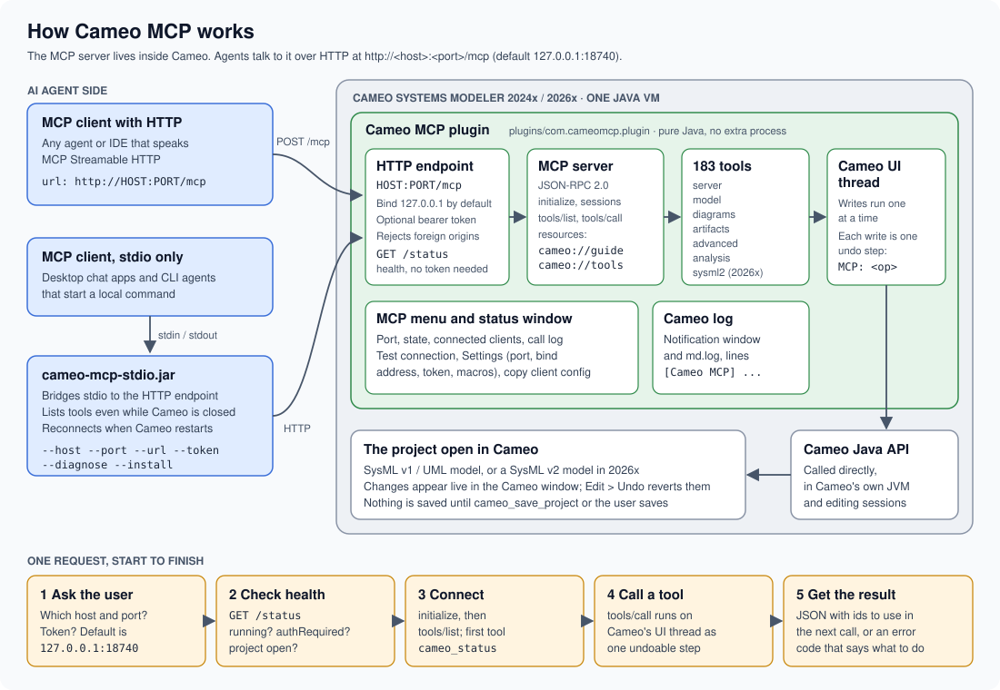

# Cameo MCP

An [MCP](https://modelcontextprotocol.io/) server that lets AI agents work inside
**Cameo Systems Modeler / CATIA Magic** (2024x and 2026x): query, create, modify, validate,
diagram, trace and review SysML/UML models in the Cameo instance you have open.

Everything is Java and ships as one package. The Cameo plugin hosts the MCP server itself and
calls Cameo's Java API directly, in Cameo's own JVM: no Python, no scripts, no helper process and
no third-party libraries. The only thing it needs is the Java that comes with Cameo.



> **If you are an AI agent:** load the skill [skills/cameo-mcp/SKILL.md](skills/cameo-mcp/SKILL.md).
> It tells you to ask the user for the server's address and port, how to connect to any host and
> port, and how to use the tools. Then read [docs/AGENT-GUIDE.md](docs/AGENT-GUIDE.md) (also served
> as the MCP resource `cameo://guide`). Start every session with `cameo_status`, then `cameo_get_project`.
> The full parameter reference is [docs/TOOLS.md](docs/TOOLS.md) and the resource `cameo://tools`.

## What you get

- **183 tools** in seven families: server (status, diagnostics, undo/redo), model (elements,
  stereotypes, relationships, specifications, state-machine semantics, bulk create, optional script macros),
  diagrams (create, populate, layout, images, labels, compartments, routing), artifacts (native
  dependency matrices, generic tables, relation maps, traceability graphs, snapshots), advanced
  (native validation, Report Wizard, requirements import/export, simulation, Teamwork Cloud,
  DataHub, criteria, profiles, variants, typed diagrams) and analysis (semantic verification,
  remediation plans, proofing, OOSEM methodology, review packets, PPTX/PDF assembly) and sysml2
  (SysML v2 projects in 2026x: browse the model, export and import SysML v2 textual notation).
  Feature parity with [ajhcs/cameo-mcp-bridge](https://github.com/ajhcs/cameo-mcp-bridge), plus
  diagram delete/rename, file export, element move, stereotype removal, bulk creation, undo/redo.
- **An MCP menu in Cameo** with a status window: server state, endpoint and port, connected
  clients, every tool call, a one-click connection self-test, settings (port, bind address,
  token, macros, logging) and copy-paste client configurations.
- **Status in Cameo's log**: server start/stop, client connections and tool calls go to the
  Notification window and to `md.log`, prefixed `[Cameo MCP]`.
- **Safe defaults**: localhost-only binding, browser-origin checks, optional bearer token, every
  change is one undoable step, writes are serialized, preview-first tools for risky operations,
  and a switch to turn script execution off.

## Requirements

- Cameo Systems Modeler or another CATIA Magic / MagicDraw-based product, **2024x or 2026x**
  (SysML features need the SysML plugin, which Cameo Systems Modeler includes).
- Nothing else. The plugin runs on Cameo's own Java; the stdio launcher can use it too.
- To build from source: JDK 17+ and Gradle 8 (optional; release zips are prebuilt).

## Install

1. Download or build `cameo-mcp-<version>.zip` and unzip it.
2. Close Cameo, then run the installer from the unzipped folder. It is part of the launcher jar,
   so it needs only Java (Cameo's bundled Java works, e.g. `"<Cameo>\jre\bin\java"`):

   ```
   java -jar launcher/cameo-mcp-stdio.jar --install
   ```

   It finds your Cameo installation (or pass `--cameo-home "<Cameo install folder>"`, repeatable;
   `--all` takes every one it finds) and copies `plugin/com.cameomcp.plugin` into
   `<Cameo>/plugins/`. Run it as administrator (Windows) or with sudo if Cameo is in a
   protected folder. Manual install is the same copy: put the folder `plugin/com.cameomcp.plugin`
   into `<Cameo install>/plugins/`.

   **From inside Cameo instead:** build `gradle :plugin:rdzip` (writes
   `build/dist/cameo-mcp-<version>-rdzip.zip`), then in Cameo open **Help > Resource/Plugin Manager**,
   click **Import**, pick that zip and restart Cameo when asked.
3. Start Cameo. The **MCP** menu appears in the main menu bar and the Notification window shows
   `[Cameo MCP] MCP server started. Endpoint http://127.0.0.1:18740/mcp ...`.
4. Open **MCP > MCP Server Status** and press **Test connection**. Every step should say PASS.

Uninstall: `java -jar launcher/cameo-mcp-stdio.jar --uninstall`, or delete
`<Cameo>/plugins/com.cameomcp.plugin`. Settings live in `~/.cameo-mcp/`.

## Connect an MCP client

The **Connect a client** tab of the status window shows these snippets with your real port,
token and paths filled in, ready to copy.

**Any client with Streamable HTTP support** (Cursor, VS Code, Windsurf, ...):

```json
{ "mcpServers": { "cameo": { "type": "http", "url": "http://127.0.0.1:18740/mcp" } } }
```

**stdio-only clients** (desktop chat apps and other clients without HTTP support): run the bundled launcher with Cameo's Java.
The jar is in the plugin folder.

```json
{
  "mcpServers": {
    "cameo": {
      "command": "C:\\Program Files\\Cameo Systems Modeler\\jre\\bin\\java.exe",
      "args": ["-jar", "C:\\Program Files\\Cameo Systems Modeler\\plugins\\com.cameomcp.plugin\\cameo-mcp-stdio.jar"]
    }
  }
}
```

The launcher answers `tools/list` even while Cameo is closed, returns a clear "start Cameo" error
for tool calls until it is up, and reconnects on its own when Cameo starts or restarts.
`java -jar cameo-mcp-stdio.jar --diagnose` checks the connection from a terminal.

**Agents whose shell runs in a sandbox, VM, container or WSL** get "connection refused" at
`127.0.0.1:18740` even when Cameo shows the server running, because their `127.0.0.1` is not the
Windows host. Register the launcher above in the MCP client's own config instead, so the client
starts it on Windows. From WSL2 you can also turn on mirrored networking (`networkingMode=mirrored`
under `[wsl2]` in `%UserProfile%\.wslconfig`, then `wsl --shutdown`) or start the launcher with
Windows `java.exe` from the WSL shell.

## Agent skill

[skills/cameo-mcp/SKILL.md](skills/cameo-mcp/SKILL.md) is a skill in the common `SKILL.md` format
(frontmatter `name` and `description`, then instructions). Copy the `skills/cameo-mcp` folder into
your agent's skills folder, or paste the file into its instructions. It makes the agent:

1. ask the user for the Cameo MCP host, port and token before its first model call,
2. check `GET http://<host>:<port>/status`,
3. connect over HTTP, through the stdio launcher, or with raw JSON-RPC requests,
4. follow the working rules for the tools.

## Configuration

Set in **MCP > MCP Server Status > Settings** (saved to `~/.cameo-mcp/settings.properties`):

| Setting | Default | Notes |
|---|---|---|
| Port | `18740` | Overridden by `-Dcameo.mcp.port=N` in Cameo's `.vmoptions`, then by env `CAMEO_MCP_PORT` |
| Bind address | `127.0.0.1` | `0.0.0.0` exposes Cameo to the network; only with a token |
| Bearer token | off | Clients send `Authorization: Bearer <token>`; launcher: `--token` or `CAMEO_MCP_TOKEN` |
| Auto-start | on | Start the server when Cameo starts |
| Allow macro scripts | off | Gates `cameo_execute_macro` and `cameo_execute_probe` |
| Notification window | errors | Which tool calls are echoed to the Notification window (`off`, `errors`, `all`); md.log gets all |

The launcher accepts `--port`, `--host`, `--url`, `--token`, `--timeout` and the matching
`CAMEO_MCP_*` environment variables.

## Endpoints

| Path | Purpose |
|---|---|
| `POST /mcp` | MCP Streamable HTTP (JSON responses; protocol 2025-06-18, 2025-03-26, 2024-11-05) |
| `DELETE /mcp` | End an MCP session |
| `GET /status` | Health and status JSON (also `/health`) |

## Troubleshooting

| Symptom | Fix |
|---|---|
| No MCP menu in Cameo | The folder must be `<Cameo>/plugins/com.cameomcp.plugin` containing `plugin.xml`. Check md.log for `[Cameo MCP]`. |
| "Port 18740 is already in use" | Another Cameo or program holds the port. Pick another port in Settings and update your client. |
| Client cannot connect | Status window > Test connection. Check the client uses the same port and, if set, the token. |
| Tool calls time out | Cameo is busy or showing a modal dialog. Look at the Cameo window. |
| `SESSION_OPEN` errors | A script left an editing session open: call `cameo_reset_session`. |
| `NO_PROJECT` | Open a project in Cameo. |

## Build from source

```sh
gradle test dist                                  # compiles against bundled API stubs
gradle test dist -PcameoHome="/path/to/Cameo"     # compiles against your Cameo install
gradle deploy -PcameoHome="/path/to/Cameo"        # copy the plugin into that Cameo
```

The release zip is `build/dist/cameo-mcp-<version>.zip`. See [docs/DEVELOPING.md](docs/DEVELOPING.md)
for the code layout and how to add tools.

## Security

The server can read and change your model and, with macros on, run arbitrary code inside Cameo.
Macros are off by default: on a machine shared by several users, anyone logged in can reach
127.0.0.1, so turn them on only on your own machine or together with a token.
Keep the default `127.0.0.1` binding; requests from non-local browser origins are rejected.
If you bind to another address, set a token. Leave macros off if your agents do not need them.

## License and credits

MIT, see [LICENSE](LICENSE). The tool set and much of the Cameo API usage are adapted from
[cameo-mcp-bridge](https://github.com/ajhcs/cameo-mcp-bridge) by Cole Lyons (MIT); see [NOTICE](NOTICE).
